

  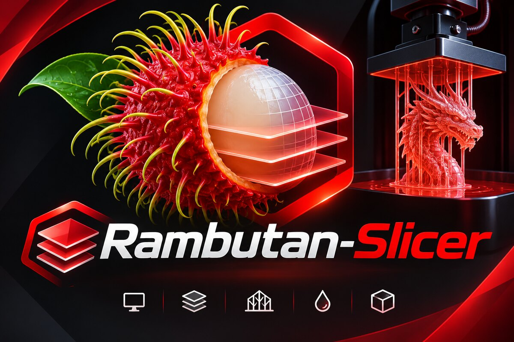

<h1 align="center">Rambutan Slicer</h1>

  Open-source MSLA/DLP resin slicer based on <a href="https://github.com/Open-Resin-Alliance/DragonFruit">DragonFruit</a> by the Open Resin Alliance.

[Português (Brasil)](README.md) · [Download](https://github.com/gilmardr/Rambutan-Slicer/releases) · [Documentation](docs/index.md) · [License](LICENSE)

Rambutan keeps DragonFruit's interactive 3D workspace, mesh repair, native Rust slicer, printer plugins and project format. It adds model preparation and print inspection tools, a new visual identity and Brazilian Portuguese localization. The sections below show how those tools fit together.

## Meet the astronaut

From a CAD helmet to a resin miniature ready for layer-by-layer inspection. These ten promotional illustrations are based on the astronaut reference. Each comes with a practical example.

### 01 · STEP and STP import

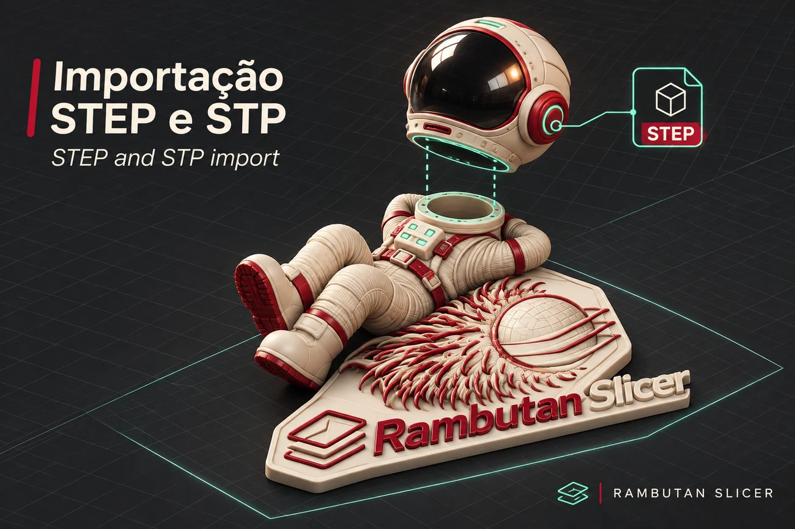

Open a `.step` or `.stp` helmet and check its dimensions on the build plate. Import the body separately to prepare both parts in one project. [Supported formats](docs/reference/file-formats.md)

### 02 · Engraving and embossing

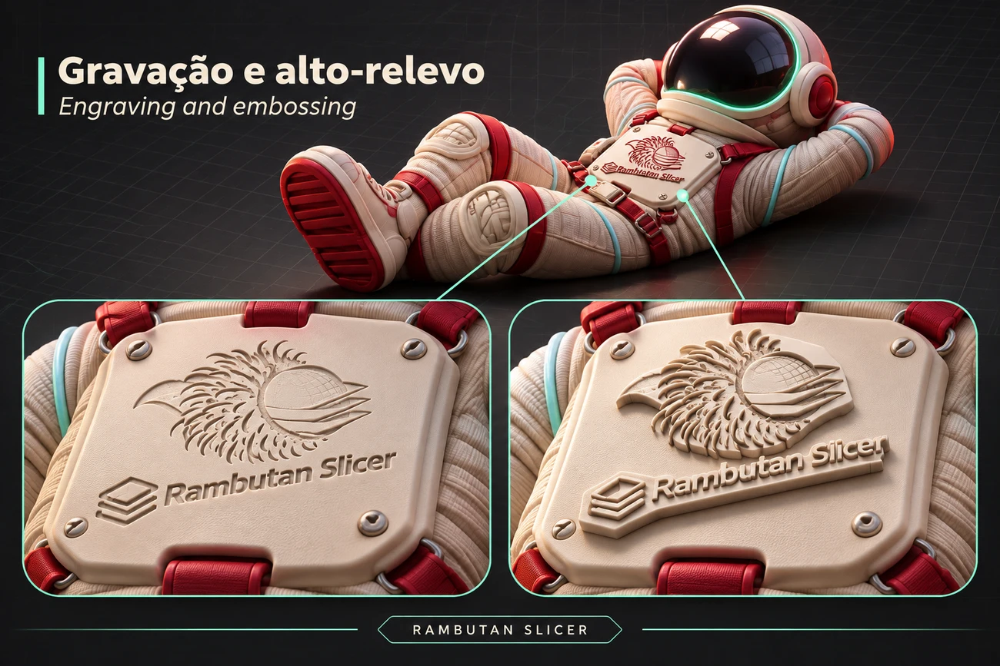

Pick the chest plate, load a transparent PNG insignia and create a preview. Choose **Engraving** to recess the mark or **Relief** to raise it. Adjust the width, depth and rotation before applying. After slicing, check how the mark appears in the layer preview. This tool is experimental.

### 03 · Auto-orientation

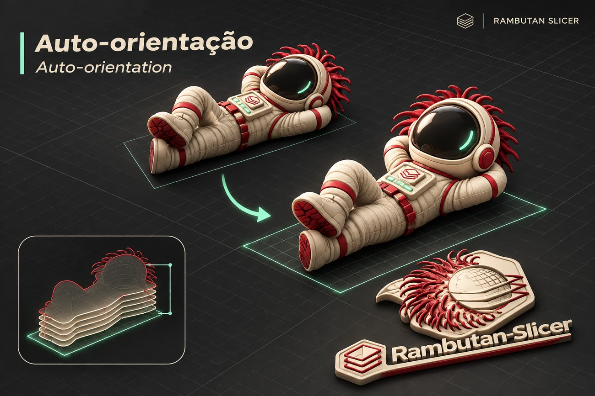

Compare a more upright pose with a tilted one. The tool evaluates layer areas in the background. Review the suggested pose and check for islands before placing supports. [Auto-orientation details](docs/dev/auto-orientation.md)

### 04 · Precision arrangement and alignment

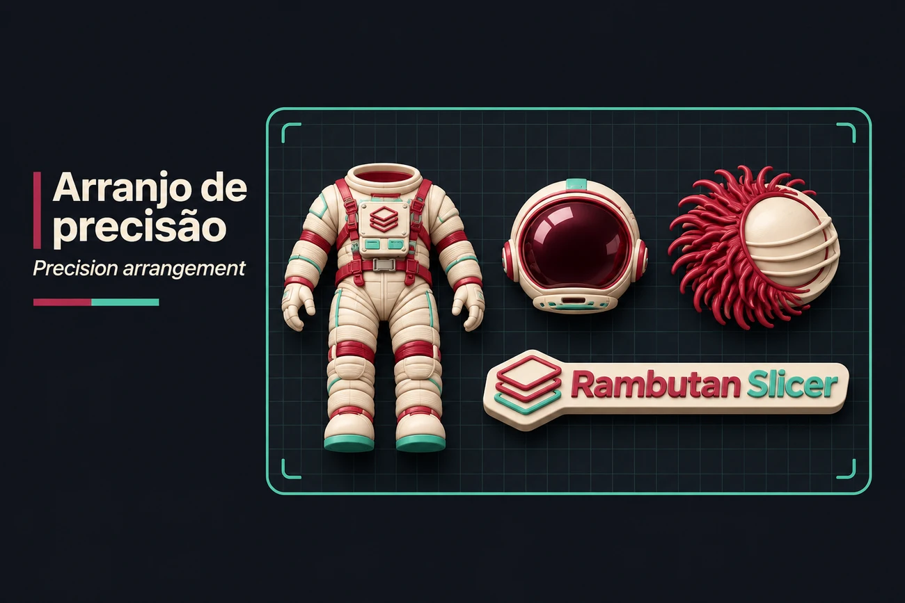

Select the body and accessories, arrange them on the plate and align the selected parts. Check the clearance between parts before generating supports. [Arrangement guide](docs/workflows/arrange-models.md)

### 05 · Cut with alignment key

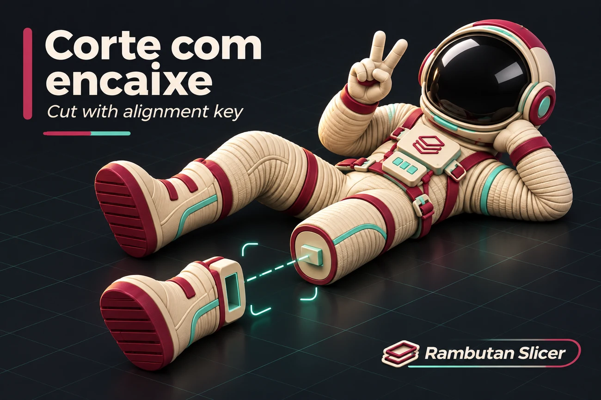

Place the cut on the leg above the boot and add a peg and its matching socket. Both boots stay intact. Inspect the mating faces in the preview, then dry-fit the printed parts. [How the alignment key works](docs/dev/organic-cut-registration.md)

### 06 · Hollowing, infill and drainage

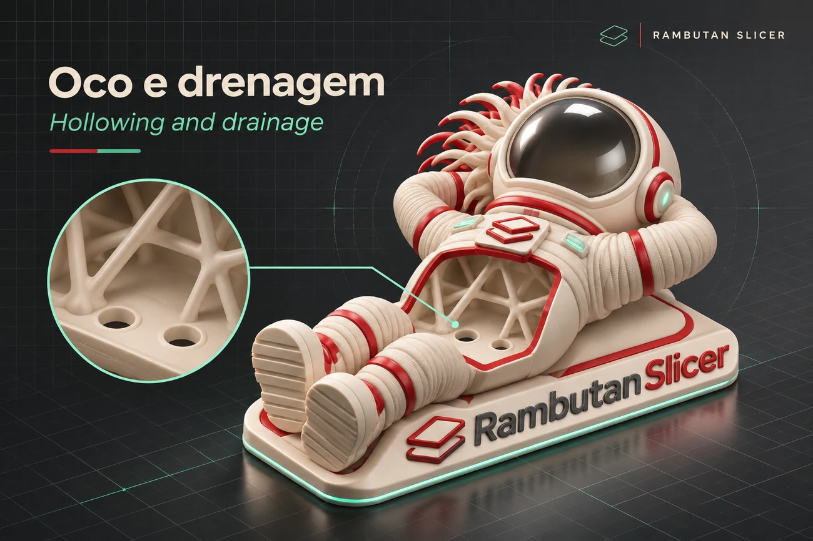

Hollow the torso, set the shell and infill, then add drainage holes. Run the connectivity check to confirm the holes reach the cavity. [Hollowing guide](docs/workflows/hollowing.md)

### 07 · Automatic supports and contour raft

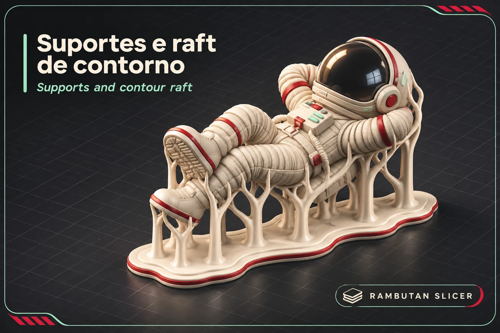

Generate grid supports for the chosen pose. Contact points branch from shared trunks, and the contour raft follows the bases. Open the model report to review rejected candidates and uncovered islands. [Automatic supports](docs/dev/auto-supports.md)

### 08 · Support painting, projection and inline placement

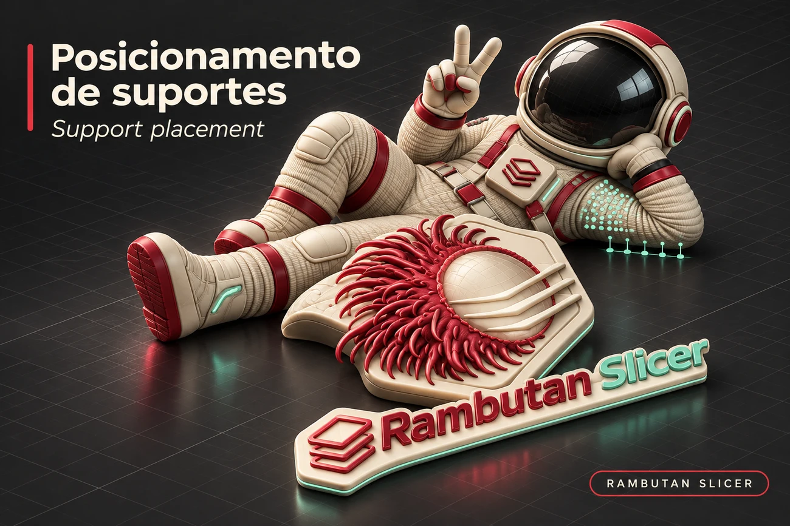

Paint contact points under the shoulder, project a pattern onto an area of the suit or place a line of supports between two points on the forearm. Zoom in to check the contacts and keep marks away from prominent surfaces. [Support placement guide](docs/workflows/support-placement.md)

### 09 · Print diagnostics

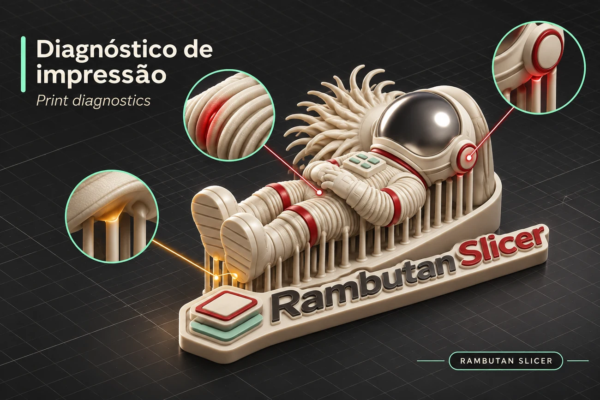

Check for floating regions using the model, supports and raft together. Review uncovered islands in the report, support shafts that pass too close to the model and cavities prone to suction. Then inspect the sliced layers.

### 10 · Measurement, collisions and scene inspection

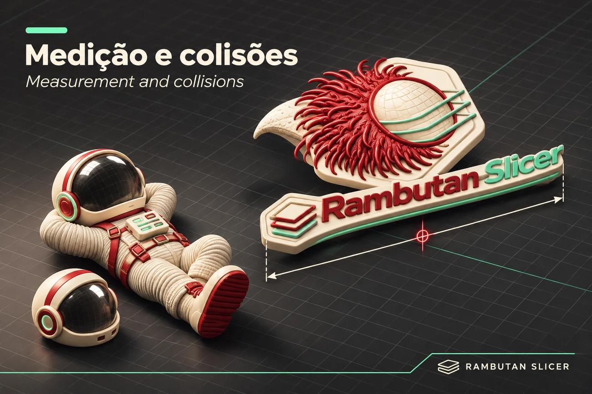

Measure helmet width between two points, clearance from a point to a plane or the gap between parallel planes. Use the build plate ruler to position parts, check collision warnings and review estimates in the model panel. Ambient occlusion helps reveal surface details in the web version as well. [Measurement tool](docs/dev/measurement.md)

## Interface and releases

Rambutan ships with its own theme, icons and installer. Saved DragonFruit themes are migrated. Brazilian Portuguese joins English, Spanish, French, German, Czech and Slovak in the language menu. The About screen links to this fork's source and credits DragonFruit.

## Download and build

- **Windows** — Download the x64 setup executable from [Releases](https://github.com/gilmardr/Rambutan-Slicer/releases).
- **macOS and Linux** — Build from source. See the [build steps in the Portuguese README](README.md#começando) and the [developer guide](DEVELOPMENT.md).
- **Local development** — Clone with submodules, install dependencies with `npm install` and run `npm run dev` for the web interface or `npm run tauri:dev` for the desktop app.

See the [contribution guide](CONTRIBUTING.md) and [security policy](SECURITY.md) for contributions and issue reporting. Validate exported files before production printing.

## Credits and license

Rambutan Slicer is a modified version of [DragonFruit](https://github.com/Open-Resin-Alliance/DragonFruit) by the Open Resin Alliance, based on upstream commit [`8bb1a22`](https://github.com/Open-Resin-Alliance/DragonFruit/commit/8bb1a22657b8c004f935f9ea7925fb0d8bc4d1a9). [gilmardr](https://github.com/gilmardr) began modifying this fork in November 2026. Changes include rebranding, support tools, measurement, organic cutting, hollowing and documentation. See the Git history for the full list of changes.

This project is distributed under [AGPL-3.0-or-later](LICENSE). The source for each release is available at its Git tag. See the [full credits](README.md#créditos) for upstream contributors and dependencies.
