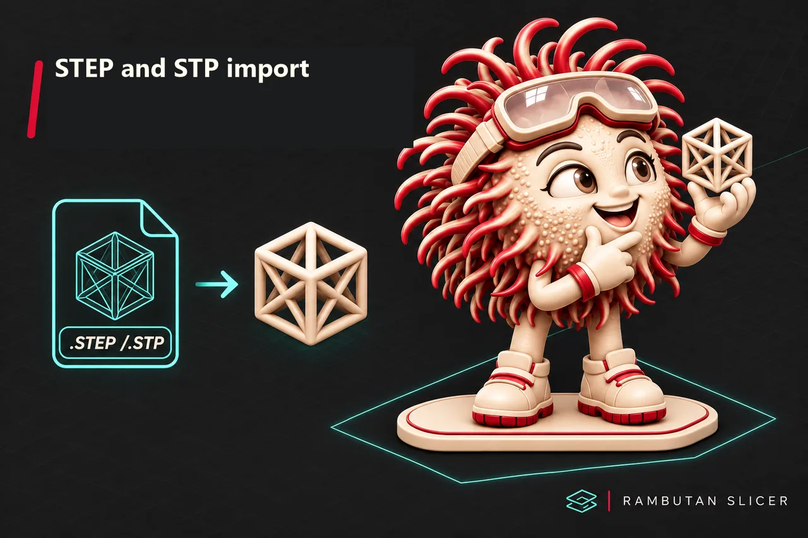
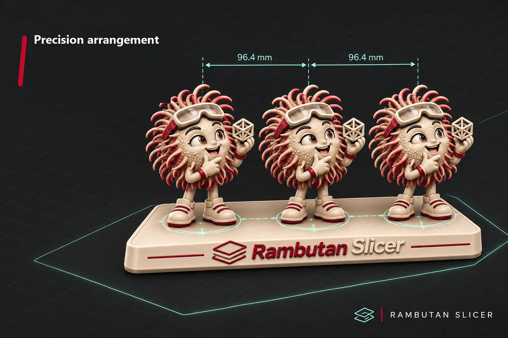
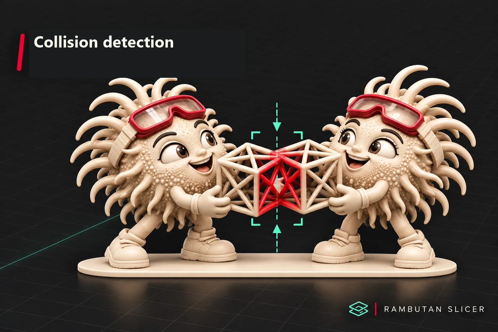
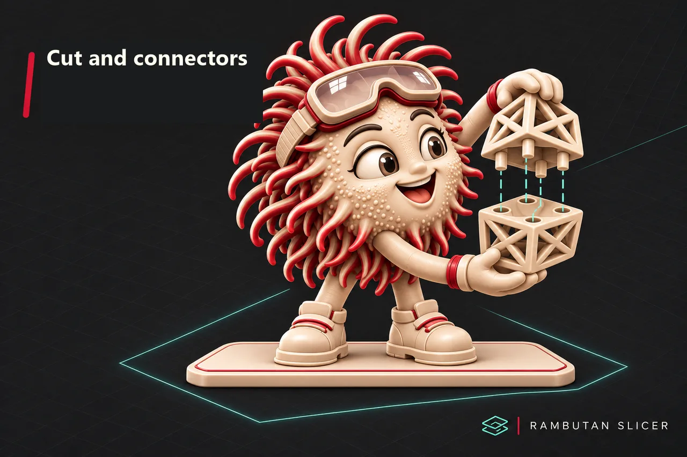
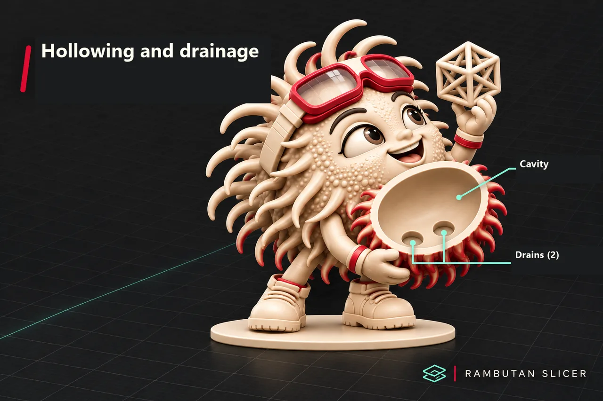
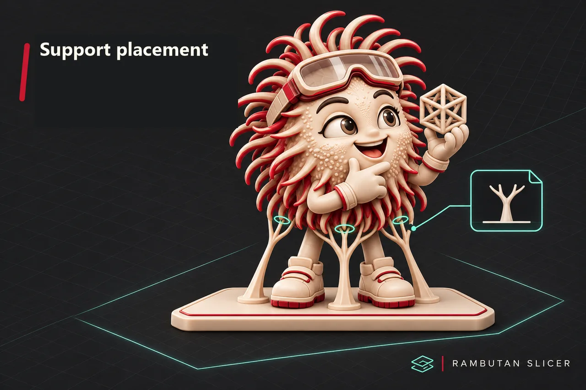
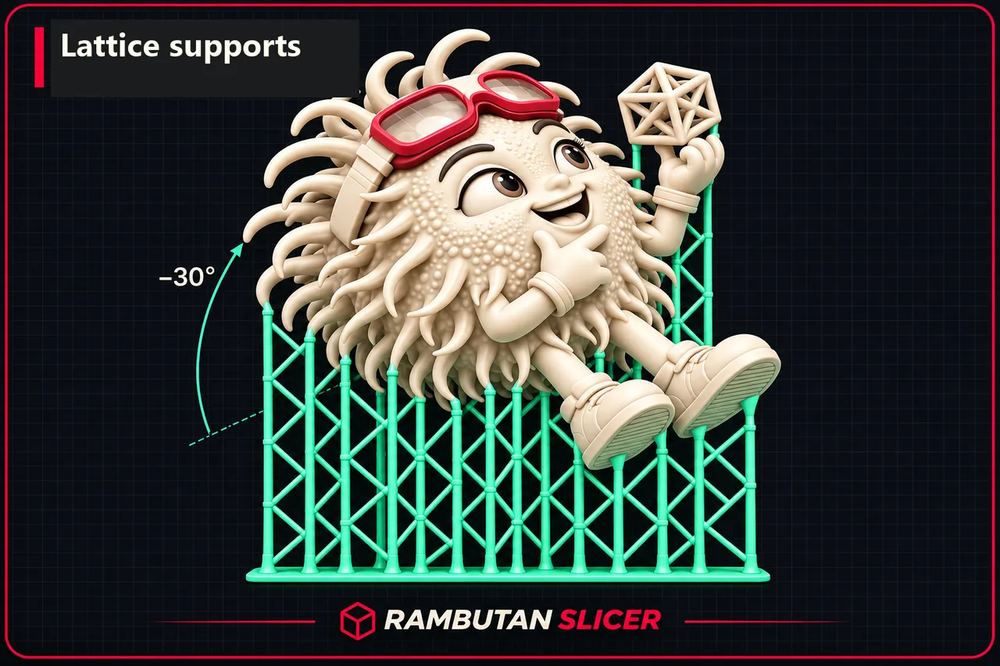
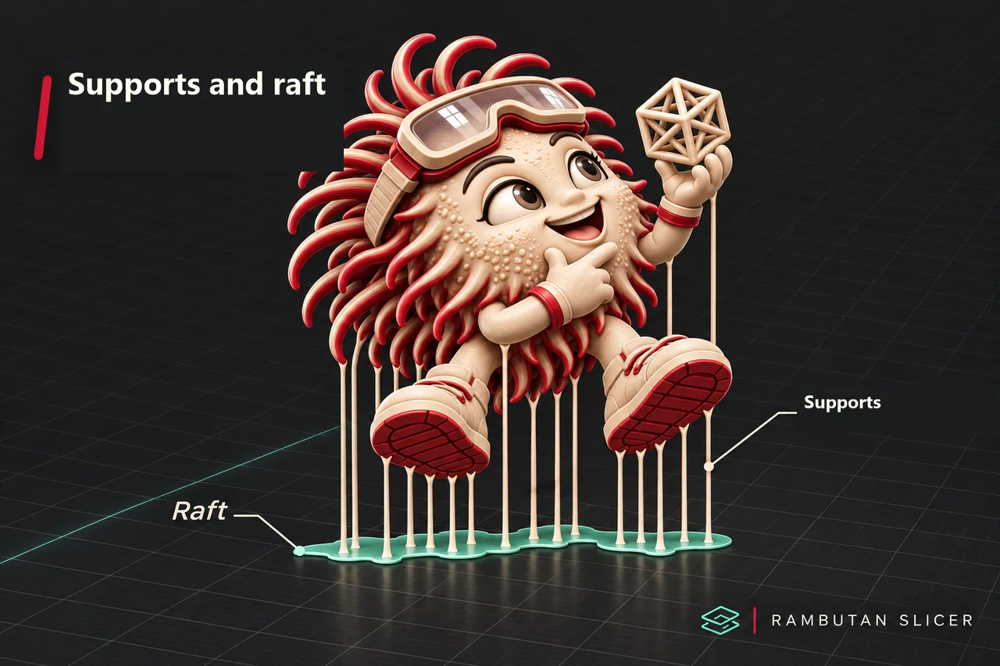
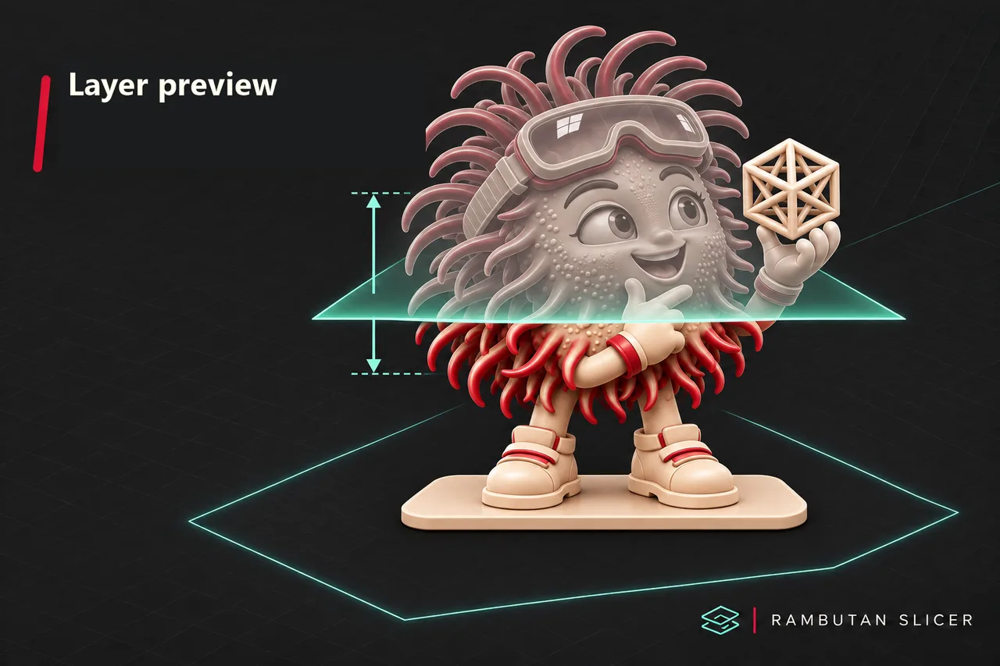

  

<h1 align="center">Rambutan Slicer</h1>

  Open-source MSLA/DLP resin slicer based on
  <a href="https://github.com/Open-Resin-Alliance/DragonFruit">DragonFruit</a> by the Open Resin Alliance.

  
  
  

<strong>English</strong> · <a href="README.md">Português (Brasil)</a>

> **Modification notice (AGPL-3.0, section 5a):** this work is a modified version of DragonFruit, derived from upstream commit [`8bb1a22`](https://github.com/Open-Resin-Alliance/DragonFruit/commit/8bb1a22657b8c004f935f9ea7925fb0d8bc4d1a9). Modified by [gilmardr](https://github.com/gilmardr) starting in November 2026: visual identity, support tools, measurement, organic cutting, hollowing, STEP import, post-slice layer editing, printer profile corrections and documentation. The full list of changes is in this repository's Git history.

> [!WARNING]
> Rambutan Slicer is based on a project under active development. Validate exported files before production printing, and watch the first print on each printer.

## Contents

- [Download](#download)
- [How it works](#how-it-works)
- [More tools](#more-tools)
- [What changes from DragonFruit](#what-changes-from-dragonfruit)
- [Printers and formats](#printers-and-formats)
- [Getting started](#getting-started)
- [Project structure](#project-structure)
- [Documentation](#documentation)
- [Contributing](#contributing)
- [Credits](#credits)
- [Trademarks](#trademarks)
- [License](#license)

## Download

Installers are on the [Releases](https://github.com/gilmardr/Rambutan-Slicer/releases) page:

- **Windows:** `Rambutan Slicer_<version>_x64-setup.exe`.
- **macOS and Linux:** no published installer yet. Build from source (see [Getting started](#getting-started)).

As the AGPL requires, the source for each release is in this repository, at the release tag.

## How it works

A model's path through Rambutan, from a CAD file to the layer check. The images are illustrations of the Rambutan Slicer mascot that explain each step; they are not screenshots of the interface.

### 1. STEP and STP import

Open `.step` and `.stp` files directly on the build plate, alongside STL, OBJ and 3MF (also inside ZIP archives). The mesh conversion runs in the background without freezing the interface. If an import fails, the diagnostics dialog shows the stage where the file stopped. [Supported formats](docs/reference/file-formats.md)

### 2. Precision arrangement

Lay out several models on the plate with even spacing and align the selected models. Check the clearance between parts before generating supports. [Arrangement guide](docs/workflows/arrange-models.md)

### 3. Collision detection

Rambutan warns you when two models on the same plate touch or overlap and would print as a single part. [How collisions are computed](docs/dev/model-collision.md)

### 4. Cut and connectors

Cut large models into parts and add a peg and matching socket so the halves line up after printing. Inspect the mating faces in the preview, then dry-fit the printed parts. [How the alignment key works](docs/dev/organic-cut-registration.md)

### 5. Hollowing and drainage

Hollow the model, set the wall thickness and infill, and add drain holes. The connectivity check confirms that every hole reaches the cavity, so resin can drain and no suction forms. [Hollowing guide](docs/workflows/hollowing.md)

### 6. Support placement

Place contacts one by one, paint supports by dragging across the surface, project a pattern onto an area, or place a line of supports between two points. The proximity warning shows shafts that pass too close to the model in red. [Support placement guide](docs/workflows/support-placement.md)

### 7. Lattice supports

Auto-supports use a 4 mm grid by default: one trunk per node, branches near the model and well-spaced bases on the plate. Automatic bracing ties the shafts together to stiffen tilted parts. [Grid and branching](docs/dev/grid-and-branching.md)

### 8. Supports and raft

The raft follows the outline of the support bases instead of covering empty areas; the previous raft shape is still available. After generating supports, the model report lists rejected candidates and uncovered islands. [Raft and export](docs/workflows/raft-and-export.md)

### 9. Layer preview

Step through the sliced file layer by layer before sending it to the printer. In CTB files you can edit a layer's pixels and scan for, or remove, unsupported islands across all layers. A final print review runs before export. [Preview and send](docs/workflows/printing-preview-and-send.md)

## More tools

- **Engraving and relief:** text or an image (PNG, JPEG or WebP) applied at a point on the surface, recessed or raised. This tool is experimental. [Engraving guide](docs/workflows/text-labels.md)
- **Auto-orientation** that scores each pose by layer area, in the background. [Details](docs/dev/auto-orientation.md)
- **Measurement** between two points, from a point to a plane or between two parallel planes, plus a millimeter ruler along the plate edges. [Measurement tool](docs/dev/measurement.md)
- **Floating-region check,** which slices the model, supports and raft together and flags every region with nothing underneath, and **suction-cup detection** for cavities that create suction. [Island analysis](docs/features/island-analysis.md)

## What changes from DragonFruit

Rambutan Slicer starts from DragonFruit at commit [`8bb1a22`](https://github.com/Open-Resin-Alliance/DragonFruit/commit/8bb1a22657b8c004f935f9ea7925fb0d8bc4d1a9) and keeps the same slicing engine, file formats (`.voxl` and the printer formats) and plugin system. DragonFruit projects open in Rambutan.

Inherited from DragonFruit: the interactive 3D workspace (`three.js` and React Three Fiber), gizmo transforms, island and volume analysis, tree, grid and raft supports, mesh repair, the native Rust slicer, printer plugins and the Tauri desktop app.

Added by Rambutan:

- The tools in [How it works](#how-it-works) and [More tools](#more-tools): STEP import, precision arrangement, collisions, cutting with alignment keys, hollowing with a drainage check, new ways to place supports, grid auto-supports, the contour raft, the per-model report and post-slice CTB layer editing.
- **CTB multi-parameter rules,** which adjust the exposure of normal layers.
- **Its own visual identity:** name, icons, installer and theme. Saved DragonFruit themes are migrated.
- **Brazilian Portuguese interface,** alongside English, Spanish, French, German, Czech and Slovak.
- **Releases from this fork** without DragonFruit's signing key or auto-update channel, and an About screen that links to this fork's source and credits DragonFruit.

Technical documentation for each tool is in [`docs/dev/`](docs/dev/).

## Printers and formats

Printer profiles come from the plugins in `plugins/` and cover models from Anycubic, Concepts3D (Athena), Creality, Elegoo and UniFormation, plus a generic profile. Output formats include CTB, GOO, Anycubic's Photon formats, CXDLPv4 (Creality's HALOT-MAGE line), NanoDLP and LUMEN. The older CXDLP (HALOT-ONE, LITE, RAY and SKY) and the HALOT-X1 series' CXDLPv4 are not written yet.

Screen dimensions in the profiles were checked against the public [UVtools](https://github.com/sn4k3/UVtools) presets and the manufacturers' specifications. When a profile is corrected, the app offers the update to anyone who already has it saved. Still, print a calibration part the first time you use a printer.

## Getting started

### Plugin submodules

Printer plugins live in Git submodules (for example `plugins/ctb`). Clone with `git clone --recurse-submodules`, or run `git submodule update --init --recursive` afterwards. If a submodule is missing, the build continues with the available plugins and reports which ones were left out.

### Interface development (Next.js)

To work on the interface without the desktop app:

1. Install Node.js (version in `.nvmrc`) and npm.
2. At the repository root, run `npm install`.
3. Start the server with `npm run dev`.
4. Open `http://localhost:3005`.

### Desktop development (Tauri + Rust)

1. Install Node.js, the Rust toolchain (version in `rust-toolchain.toml`) and the [Tauri prerequisites](https://tauri.app/start/prerequisites/) for your system.
2. Run `npm install`.
3. Start with `npm run tauri:dev`. Interface and Rust changes are tested through the same flow.

### Production build

1. **Frontend:** `npm run build` (or `npm run build:tauri` for the Tauri artifacts).
2. **Desktop:** `npm run tauri:build`.
3. **Installers:** `npm run tauri:bundle` for the current machine, or a specific target:
   - `npm run tauri:bundle:windows`
   - `npm run tauri:bundle:linux`
   - `npm run tauri:bundle:macos:universal`: universal `.dmg` for Intel and Apple Silicon.
   - `npm run tauri:bundle:macos` / `npm run tauri:bundle:macos:arm64`: single-architecture shortcuts, for local development only.

The desktop build tests the file extensions the interface advertises before packaging. On Windows, the check uses the installed Microsoft Edge. On macOS, prepare the browser with `npx playwright-core install chromium`. On Linux, use `npx playwright-core install --with-deps chromium`. To repeat the check on an already built frontend, run `npm run verify:release-imports`. The report written to `release-verification/` includes the results and [usage notes](docs/release/NOTAS.md) (in Portuguese).

## Project structure

- `src/` — Next.js app: React components, 3D scene, support systems, hooks, translation catalogs and utilities.
- `src-tauri/` — Tauri desktop host and native integration.
- `rust/` — native crates: slicing, mesh repair, islands, organic cutting, CLI and more.
- `plugins/` — printer plugins and integrations (with their own licenses).
- `profiles/` — printer and material profiles.
- `docs/` — user guides, reference, developer documentation and architecture decisions (`docs/adr/`).

## Documentation

- [User guide and reference](docs/index.md)
- [Quick start](docs/getting-started/quick-start.md) and [building from source](docs/getting-started/building-from-source.md)
- [Developer guide](DEVELOPMENT.md) — project rules, i18n, lint, undo/redo history and crate versions.
- [Localization (i18n)](docs/dev/localization.md)
- [Domain glossary](CONTEXT.md)
- [Licensing and compliance](README-LICENCIAMENTO.md) (in Portuguese)

## Contributing

Contributions are welcome. Read the [contribution guide](CONTRIBUTING.md) and the [Code of Conduct](CODE_OF_CONDUCT.md) before opening a pull request. Report security issues privately, as described in the [security policy](SECURITY.md).

If a problem also exists in DragonFruit, consider fixing it in the [original project](https://github.com/Open-Resin-Alliance/DragonFruit).

## Credits

Rambutan Slicer exists thanks to other people's work:

- **[DragonFruit](https://github.com/Open-Resin-Alliance/DragonFruit)**, by the **[Open Resin Alliance](https://github.com/Open-Resin-Alliance)** and everyone who has [contributed](https://github.com/Open-Resin-Alliance/DragonFruit/graphs/contributors) to it: the foundation of the whole application, from the 3D workspace to the slicing engine. The upstream commit history is preserved in this repository.
- **Printer plugins** by the Open Resin Alliance in `plugins/`, each under its own license (MIT for the plugins checked so far). The CTB, Anycubic and Elegoo plugins use forks under [gilmardr](https://github.com/gilmardr), branch `rambutan`, with this project's changes.
- **[Open CASCADE Technology](https://dev.opencascade.org/)** and **[occt-import-js](https://github.com/kovacsv/occt-import-js)** by Viktor Kovács, through the [`@sunbox/occt-import-js`](https://github.com/SunboX/occt-import-js) package (LGPL-2.1, with the OCCT exception), used for STEP import. Their license notices ship with the files in `public/vendor/occt-import-js/`.
- **[TetGen](https://codeberg.org/TetGen/TetGen)** by Hang Si and WIAS Berlin (AGPL-3.0), used for tetrahedral meshing.
- **[UVtools](https://github.com/sn4k3/UVtools)** by Tiago Conceição, whose public printer presets served as a reference to check screen dimensions.
- **Open-source libraries**, including [three.js](https://threejs.org/), [React Three Fiber](https://github.com/pmndrs/react-three-fiber), [Next.js](https://nextjs.org/), [React](https://react.dev/), [Tauri](https://tauri.app/), [Lingui](https://lingui.dev/), [Manifold](https://github.com/elalish/manifold), [three-mesh-bvh](https://github.com/gkjohnson/three-mesh-bvh), [Zustand](https://github.com/pmndrs/zustand) and [Lucide](https://lucide.dev/). Each dependency's license is in its package.
- **Everyone who translated** DragonFruit and Rambutan Slicer.

To support the original project, see the [Open Resin Alliance Open Collective](https://opencollective.com/openresinalliance).

## Trademarks

Anycubic, Photon, Elegoo, Saturn, Mars, Jupiter, Creality, Halot, UniFormation, Concepts3D, Athena, CHITUBOX, Lychee and the other product names mentioned belong to their respective owners. They appear here only to identify compatible printers and formats. Rambutan Slicer is not affiliated with or endorsed by these companies.

## License

Unless a subdirectory or submodule states otherwise, Rambutan Slicer is licensed under the **GNU Affero General Public License, version 3 or later (AGPL-3.0-or-later)**, the same as DragonFruit. See [`LICENSE`](LICENSE) for the full terms.

The plugin submodules in `plugins/` have their own licenses, stated in each repository's `LICENSE` file.

[README-LICENCIAMENTO.md](README-LICENCIAMENTO.md) (in Portuguese) explains the relationship with the upstream license, the modification notices and the obligations when distributing the application.

---

Rambutan Slicer is an independent fork of DragonFruit and is not an official Open Resin Alliance product. All upstream credits are preserved under AGPL-3.0-or-later.
