

  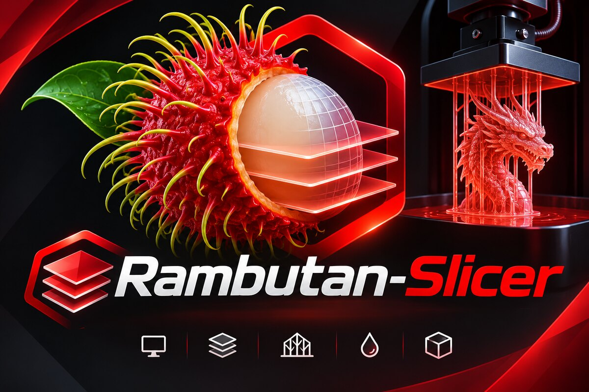

<h1 align="center">Rambutan Slicer</h1>

  Slicer de resina para impressão 3D (MSLA/DLP), de código aberto, derivado do
  <a href="https://github.com/Open-Resin-Alliance/DragonFruit">DragonFruit</a> da Open Resin Alliance.

  
  
  

[English](README.en.md) · [Galeria do astronauta](#o-astronauta-no-rambutan-slicer)

> **Aviso de modificação (AGPL-3.0, seção 5a):** este trabalho é uma versão modificada do DragonFruit, derivada do commit upstream [`8bb1a22`](https://github.com/Open-Resin-Alliance/DragonFruit/commit/8bb1a22657b8c004f935f9ea7925fb0d8bc4d1a9). Modificado por [gilmardr](https://github.com/gilmardr) a partir de novembro de 2026 (rebranding, novas ferramentas de suporte, medição, corte orgânico, hollowing e documentação). O histórico completo das alterações está no log do Git deste repositório.

> [!WARNING]
> O Rambutan Slicer é baseado em um projeto em desenvolvimento ativo. Valide os arquivos gerados antes de usá-los em impressões de produção e evite imprimir sem acompanhamento no primeiro uso.

## Sumário

- [Download](#download)
- [Funcionalidades](#funcionalidades)
- [O que muda em relação ao DragonFruit](#o-que-muda-em-relação-ao-dragonfruit)
- [Galeria do astronauta](#o-astronauta-no-rambutan-slicer)
- [Começando](#começando)
- [Estrutura do projeto](#estrutura-do-projeto)
- [Documentação](#documentação)
- [Contribuindo](#contribuindo)
- [Créditos](#créditos)
- [Licença](#licença)

## Download

Os instaladores ficam na página de [Releases](https://github.com/gilmardr/Rambutan-Slicer/releases):

- **Windows:** `Rambutan Slicer_<versão>_x64-setup.exe`.
- **macOS e Linux:** ainda sem instalador publicado; compile a partir do código-fonte (veja [Começando](#começando)).

Como exige a AGPL, o código-fonte correspondente a cada versão está neste repositório, na tag da release.

## Funcionalidades

Herdadas do DragonFruit:

- **Workspace 3D interativo** com `three.js` e `react-three-fiber`.
- **Transformações** mover, rotacionar e escalar com controles de precisão e gizmos.
- **Análise de ilhas e de volume** para encontrar regiões sem suporte camada a camada.
- **Suportes** em árvore, grade e raft, com posicionamento manual e automático.
- **Reparo de malha** e **fatiamento nativo em Rust**, com exportação para vários formatos de impressora por plugins.
- **App desktop via Tauri**, com perfis de impressora e material.

O que o Rambutan Slicer acrescenta está na seção seguinte.

## O que muda em relação ao DragonFruit

O Rambutan Slicer parte do DragonFruit no commit [`8bb1a22`](https://github.com/Open-Resin-Alliance/DragonFruit/commit/8bb1a22657b8c004f935f9ea7925fb0d8bc4d1a9) e mantém o mesmo motor de fatiamento, os mesmos formatos de arquivo (`.voxl` e os formatos de impressora) e o mesmo sistema de plugins. Projetos do DragonFruit abrem no Rambutan. As diferenças estão nas ferramentas abaixo. A documentação técnica de cada uma está em `docs/dev/`.

### Suportes

- **Auto-suporte em grade por padrão.** Um tronco por nó de uma grade de 4 mm, com os demais contatos ramificando perto do modelo. As bases ficam mais espaçadas na plataforma, e pontas muito próximas da plataforma recebem tocos compactos em vez de ficarem sem suporte. A densidade de contatos do DragonFruit foi mantida.
- **Relatório por modelo** depois de cada geração: candidatos rejeitados e ilhas que ficaram sem cobertura, com um botão para verificar o modelo na hora.
- **Verificação de regiões flutuantes.** Fatia o modelo junto com os suportes e o raft, com a mesma geometria usada na impressão, e aponta toda região sem nada embaixo. Gerar suportes em modo "adicionar" cobre essas regiões.
- **Raft com contorno.** O raft acompanha as bases dos suportes em vez de cobrir o fecho convexo de todas elas, sem placa em áreas vazias. O formato antigo continua disponível.
- **Novas formas de posicionar contatos:** pintura de suportes (arrastar sobre a superfície), projeção de um padrão sobre uma área e suportes em linha entre dois pontos.
- **Diagnósticos:** proximidade entre suportes e modelo (hastes perto demais aparecem em vermelho) e detecção de ventosas, as regiões côncavas que fazem efeito de sucção e precisam de drenagem.

### Preparação do modelo

- **Importação STEP e STP.** Abra modelos de CAD diretamente na mesa de preparação.
- **Gravação e relevo.** Texto ou imagem (PNG, JPEG ou WebP) aplicados num ponto da superfície do modelo, gravados para dentro ou em relevo para fora. A prévia pode ser girada e reposicionada antes de confirmar, e o resultado é uma única ação de desfazer.
- **Auto-orientação** que avalia cada pose pela área das camadas, calculada em segundo plano sem travar a interface.
- **Arranjo de alta precisão** e alinhamento dos modelos selecionados.
- **Corte orgânico com encaixe:** espiga e encaixe para as duas metades se alinharem depois de impressas.
- **Hollowing com preenchimento interno** e verificação dos furos de drenagem, que confere se cada furo alcança a cavidade.

### Análise e cena

- **Medição** entre dois pontos, de um ponto a um plano ou entre dois planos paralelos.
- **Colisão entre modelos:** avisa quando dois modelos na mesma placa se tocam ou se sobrepõem e vão imprimir como uma peça só.
- **Régua milimétrica** nas bordas da plataforma, com o logotipo do Rambutan na placa.
- **Painel de estatísticas do modelo** redesenhado.
- **Sombreamento** com oclusão de ambiente também na versão web.

### Distribuição e idioma

- **Identidade visual própria:** nome, ícones, instalador e tema. Os temas salvos do DragonFruit são migrados.
- **Interface em português do Brasil**, além dos idiomas do DragonFruit (inglês, espanhol, francês, alemão, tcheco e eslovaco).
- **Releases deste fork** sem a assinatura nem o canal de atualização automática do DragonFruit.
- **Tela Sobre** com o link para o código-fonte desta versão e o crédito ao DragonFruit.

## O astronauta no Rambutan Slicer

De um capacete CAD a uma miniatura pronta para inspecionar camada por camada. As dez imagens são ilustrações promocionais baseadas na referência do astronauta. Os exemplos abaixo descrevem como usar cada ferramenta.

### 01 · Importação STEP e STP

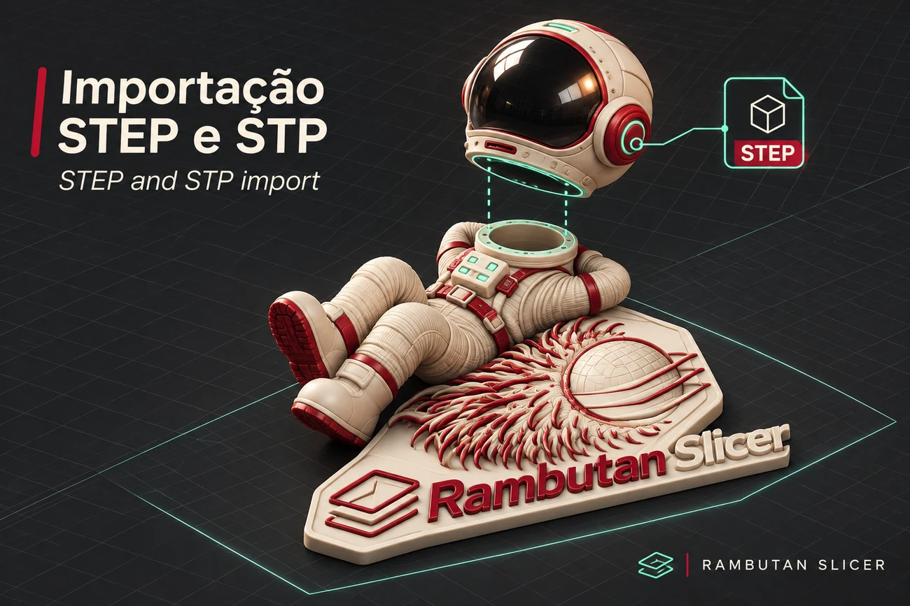

Abra o capacete em `.step` ou `.stp` e confira as dimensões na mesa. Importe o corpo separadamente para preparar as duas peças no mesmo projeto. [Formatos aceitos](docs/reference/file-formats.md)

### 02 · Gravação e alto-relevo

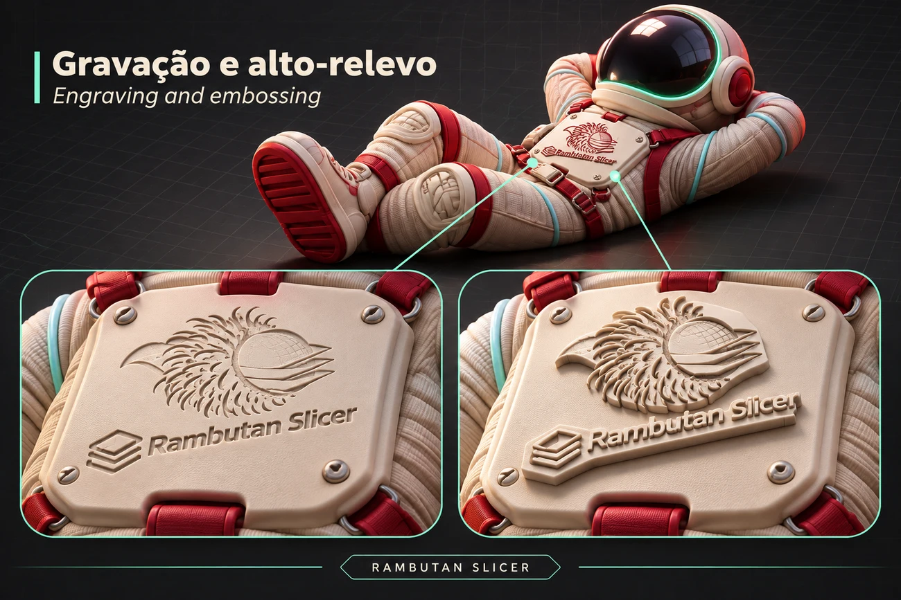

Escolha a placa do peito, carregue uma insígnia em PNG transparente e gere a prévia. Use **Gravação** para rebaixar a marca ou **Relevo** para fazê-la sobressair. Ajuste a largura, a profundidade e a rotação antes de aplicar. Depois do fatiamento, confira como a marca aparece nas camadas. A ferramenta é experimental.

### 03 · Auto-orientação

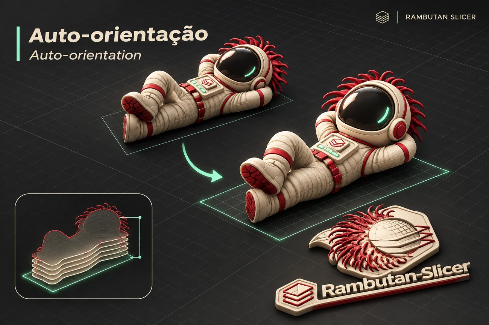

Compare uma pose mais vertical com outra mais inclinada. A ferramenta analisa a área das camadas em segundo plano. Confira a pose sugerida e inspecione as ilhas antes de colocar os suportes. [Detalhes da auto-orientação](docs/dev/auto-orientation.md)

### 04 · Arranjo de precisão e alinhamento

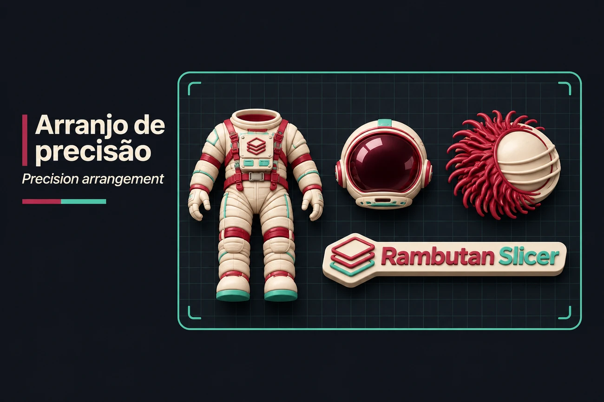

Selecione o corpo e os acessórios, organize-os na placa e alinhe as peças selecionadas. Confira a folga entre elas antes de gerar suportes. [Guia de arranjo](docs/workflows/arrange-models.md)

### 05 · Corte com encaixe

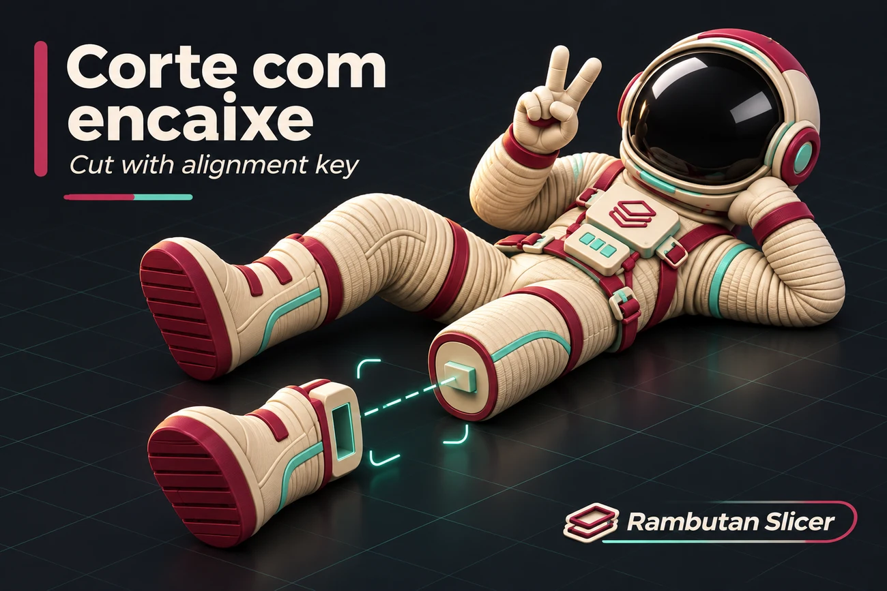

Posicione o corte na perna, acima da bota, e adicione uma espiga com seu encaixe correspondente. As duas botas ficam inteiras. Confira as faces de união na prévia e faça um encaixe a seco depois da impressão. [Como funciona o encaixe](docs/dev/organic-cut-registration.md)

### 06 · Oco, preenchimento e drenagem

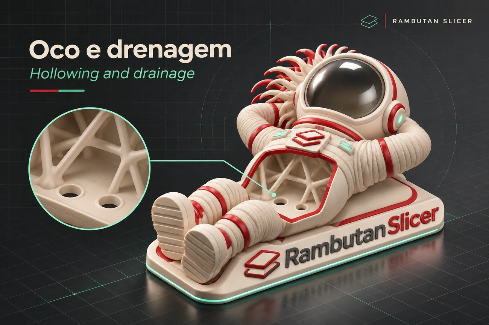

Deixe o torso oco, ajuste a parede e o preenchimento interno e acrescente furos de drenagem. Use a verificação de conectividade para confirmar que os furos alcançam a cavidade. [Guia de hollowing](docs/workflows/hollowing.md)

### 07 · Suportes automáticos e raft de contorno

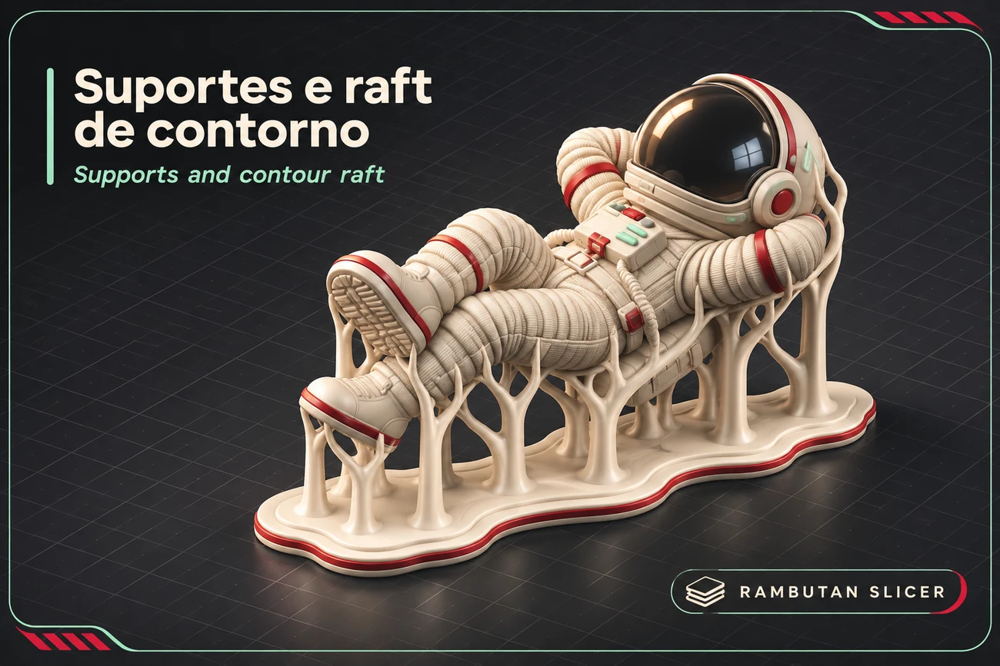

Gere suportes em grade para a pose escolhida. Os contatos se ramificam a partir dos troncos e o raft de contorno acompanha as bases. Abra o relatório do modelo para revisar candidatos rejeitados e ilhas sem cobertura. [Suportes automáticos](docs/dev/auto-supports.md)

### 08 · Pintura, projeção e suportes em linha

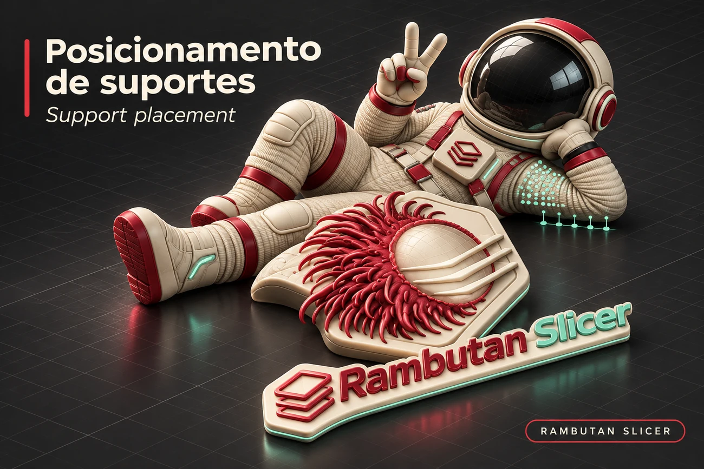

Pinte contatos sob o ombro, projete um padrão numa área do traje ou distribua uma linha entre dois pontos do antebraço. Confira os contatos de perto para evitar marcas em áreas de destaque. [Guia de posicionamento](docs/workflows/support-placement.md)

### 09 · Diagnóstico de impressão

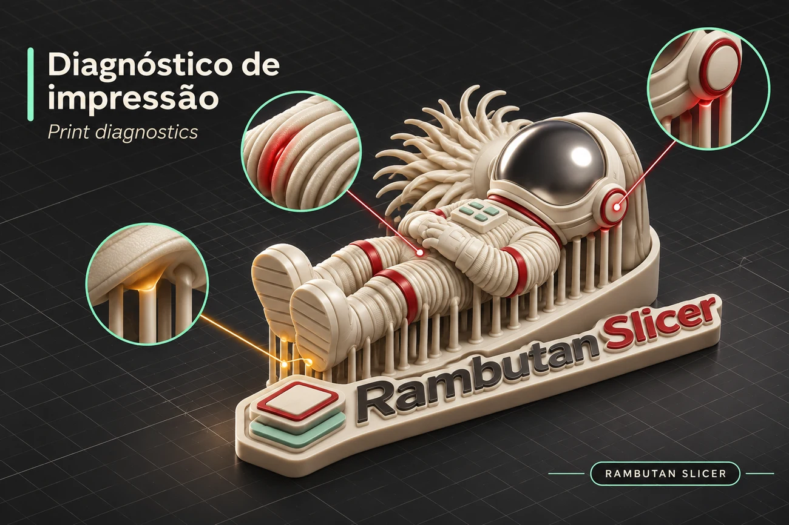

Verifique regiões flutuantes com modelo, suportes e raft juntos. Revise as ilhas sem cobertura no relatório, o alerta de hastes próximas demais e as cavidades suscetíveis à sucção. Em seguida, confira as camadas no fatiamento.

### 10 · Medição, colisões e leitura da cena

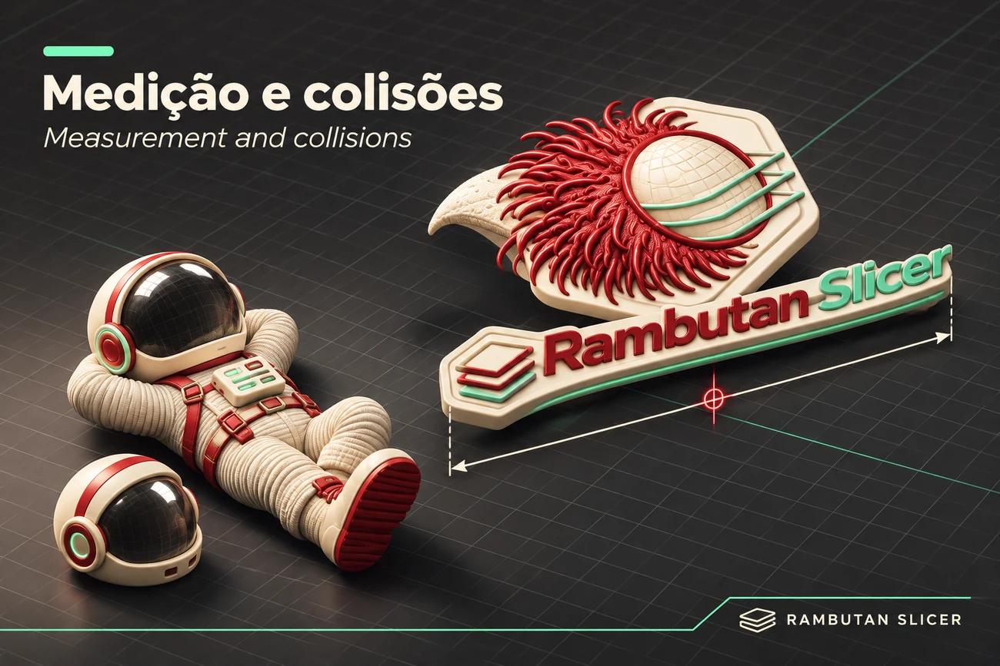

Meça a largura do capacete entre dois pontos, a distância até um plano ou o vão entre planos paralelos. Use a régua da placa para posicionar as peças, verifique avisos de colisão e confira as estimativas no painel do modelo. A oclusão de ambiente ajuda a ler a cena também na versão web. [Ferramenta de medição](docs/dev/measurement.md)

## Começando

### Submódulos de plugins

Os plugins de impressora ficam em submódulos Git (por exemplo `plugins/ctb`). Clone com `git clone --recurse-submodules` ou rode `git submodule update --init --recursive` depois. Se algum submódulo faltar, o build continua com os plugins disponíveis e avisa quais ficaram de fora.

### Desenvolvimento da interface (Next.js)

Para trabalhar só na interface, sem o app desktop:

1. Instale o Node.js (versão em `.nvmrc`) e o npm.
2. Na raiz do repositório, rode `npm install`.
3. Inicie o servidor com `npm run dev`.
4. Abra `http://localhost:3005`.

### Desenvolvimento desktop (Tauri + Rust)

1. Instale o Node.js, a toolchain Rust (versão em `rust-toolchain.toml`) e as [dependências do Tauri](https://tauri.app/start/prerequisites/) para o seu sistema.
2. Rode `npm install`.
3. Inicie com `npm run tauri:dev`. Alterações na interface e no Rust são testadas pelo mesmo fluxo.

### Build de produção

1. **Frontend:** `npm run build` (ou `npm run build:tauri` para os artefatos do Tauri).
2. **Desktop:** `npm run tauri:build`.
3. **Instaladores:** `npm run tauri:bundle` para a máquina atual, ou um alvo específico:
   - `npm run tauri:bundle:windows`
   - `npm run tauri:bundle:linux`
   - `npm run tauri:bundle:macos:universal`: `.dmg` universal para Intel e Apple Silicon.
   - `npm run tauri:bundle:macos` / `npm run tauri:bundle:macos:arm64`: atalhos de uma arquitetura, só para desenvolvimento local.

A build desktop testa as extensões anunciadas pela interface antes de empacotar. No Windows, a verificação usa o Microsoft Edge instalado. No macOS, prepare o navegador com `npx playwright-core install chromium`. No Linux, use `npx playwright-core install --with-deps chromium`. Para repetir a verificação do frontend já preparado, rode `npm run verify:release-imports`. O relatório gerado em `release-verification/` inclui os resultados e as [instruções de uso](docs/release/NOTAS.md).

## Estrutura do projeto

- `src/` — app Next.js: componentes React, cena 3D, sistemas de suporte, hooks, catálogos de tradução e utilitários.
- `src-tauri/` — host desktop Tauri e integração nativa.
- `rust/` — crates nativos: fatiamento, reparo de malha, ilhas, corte orgânico, CLI e outros.
- `plugins/` — plugins de impressoras e integrações (licenças próprias).
- `profiles/` — perfis de impressora e material.
- `docs/` — guias de uso, referência, documentação de desenvolvimento e decisões de arquitetura (`docs/adr/`).

## Documentação

- [Guia de uso e referência](docs/index.md)
- [Guia de desenvolvimento](DEVELOPMENT.md) — regras do projeto, i18n, lint, histórico de desfazer/refazer e versões dos crates.
- [Localização (i18n)](docs/dev/localization.md)
- [Glossário do domínio](CONTEXT.md)

## Contribuindo

Contribuições são bem-vindas. Leia o [guia de contribuição](CONTRIBUTING.md) e o [Código de Conduta](CODE_OF_CONDUCT.md) antes de abrir um pull request. Falhas de segurança devem ser reportadas de forma privada, conforme a [política de segurança](SECURITY.md).

Se o problema também existe no DragonFruit, considere corrigi-lo no [projeto original](https://github.com/Open-Resin-Alliance/DragonFruit).

## Créditos

O Rambutan Slicer só existe graças ao trabalho de outras pessoas:

- **[DragonFruit](https://github.com/Open-Resin-Alliance/DragonFruit)**, da **[Open Resin Alliance](https://github.com/Open-Resin-Alliance)** e de todos os seus [colaboradores](https://github.com/Open-Resin-Alliance/DragonFruit/graphs/contributors): a base de todo o aplicativo, do workspace 3D ao motor de fatiamento. O histórico de commits deles está preservado neste repositório.
- **[TetGen](https://codeberg.org/TetGen/TetGen)**, de Hang Si e do WIAS Berlin (AGPL-3.0), usado na malha tetraédrica.
- **Plugins de impressora** em `plugins/`, cada um com seus autores e licença (MIT nos plugins verificados).
- **Bibliotecas de código aberto**, entre elas [three.js](https://threejs.org/), [React Three Fiber](https://github.com/pmndrs/react-three-fiber), [Next.js](https://nextjs.org/), [React](https://react.dev/), [Tauri](https://tauri.app/), [Lingui](https://lingui.dev/), [Manifold](https://github.com/elalish/manifold), [three-mesh-bvh](https://github.com/gkjohnson/three-mesh-bvh), [Zustand](https://github.com/pmndrs/zustand) e [Lucide](https://lucide.dev/). As licenças de cada dependência estão nos respectivos pacotes.
- **Tradutores** do DragonFruit e do Rambutan Slicer.

Para apoiar o projeto original, veja o [Open Collective da Open Resin Alliance](https://opencollective.com/openresinalliance).

## Licença

A menos que um subdiretório ou submódulo declare o contrário, o Rambutan Slicer é licenciado sob a **GNU Affero General Public License, versão 3 ou posterior (AGPL-3.0-or-later)**, a mesma do DragonFruit. Veja o arquivo [`LICENSE`](LICENSE) para os termos completos.

Os submódulos de plugins em `plugins/` têm licença própria, declarada no `LICENSE` de cada repositório.

O [README-LICENCIAMENTO.md](README-LICENCIAMENTO.md) explica a relação com a licença upstream, os avisos de modificação e as obrigações ao distribuir o aplicativo.

---

Rambutan Slicer é um fork independente do DragonFruit e não é um produto oficial da Open Resin Alliance. Todos os créditos upstream estão preservados conforme a AGPL-3.0-or-later.
