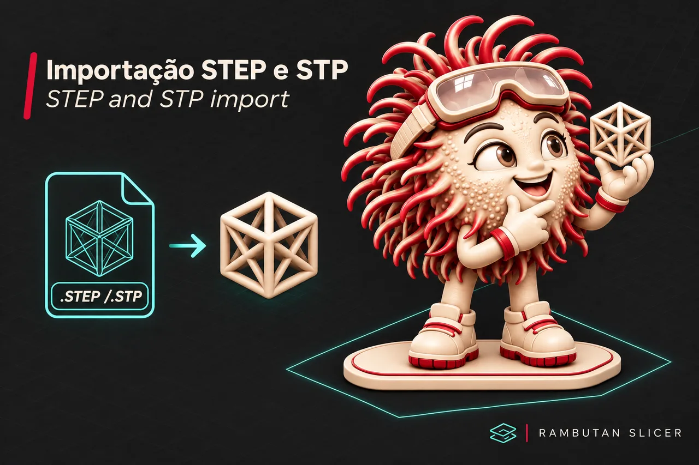
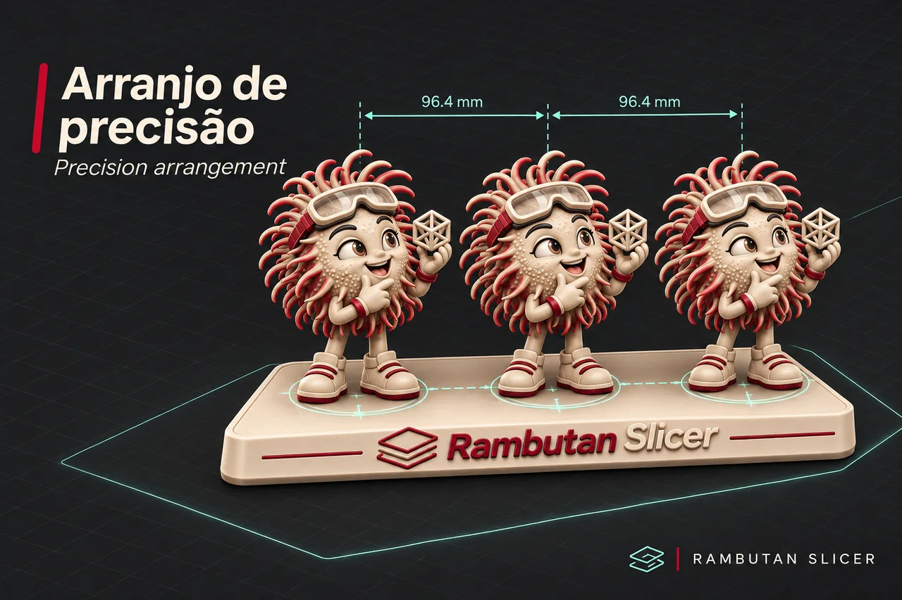
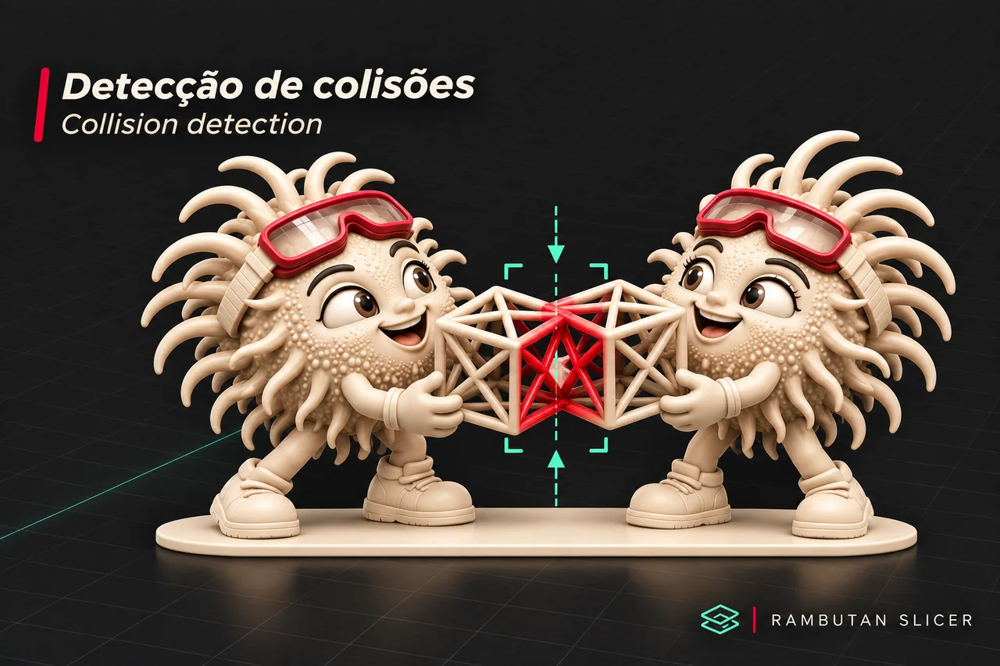
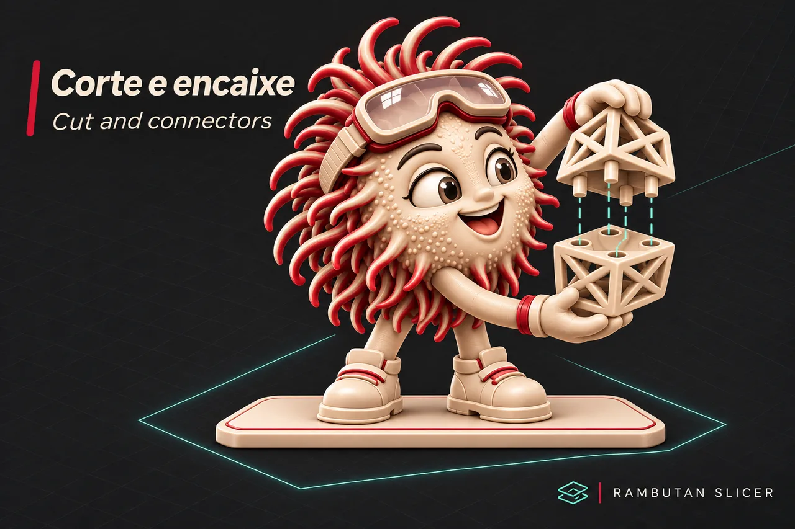
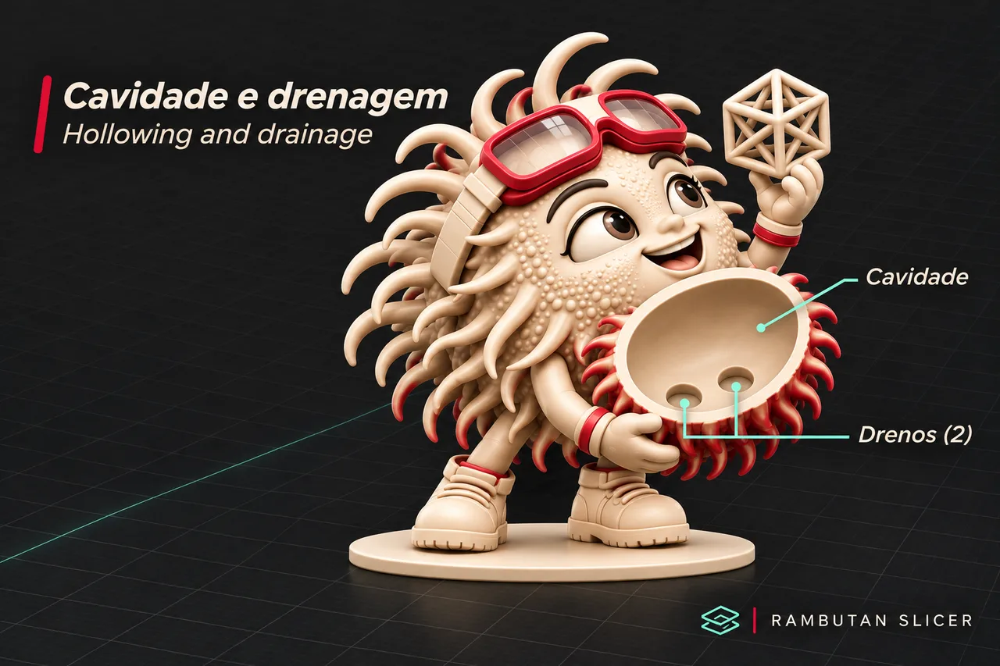
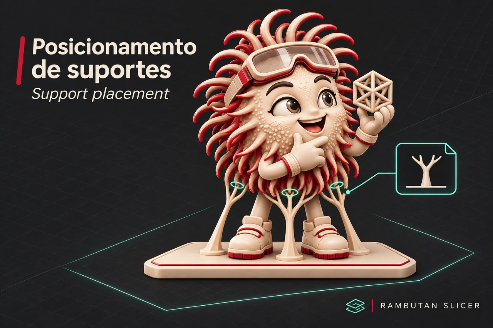
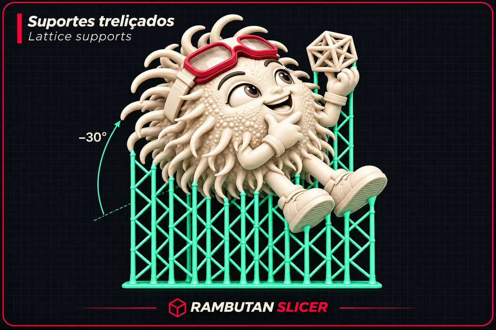
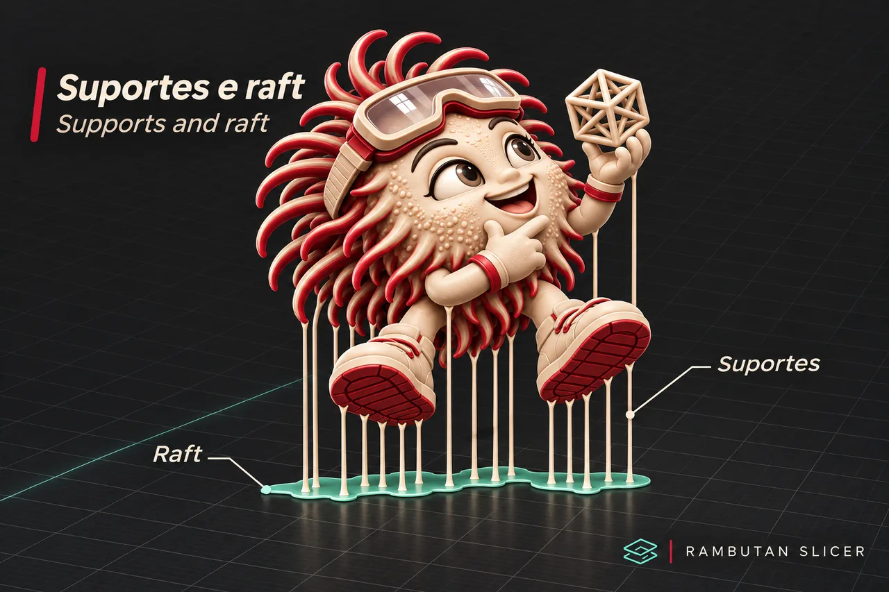
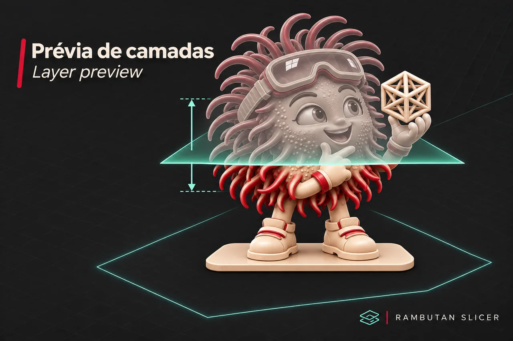

  

<h1 align="center">Rambutan Slicer</h1>

  Slicer de resina para impressão 3D (MSLA/DLP), de código aberto, derivado do
  <a href="https://github.com/Open-Resin-Alliance/DragonFruit">DragonFruit</a> da Open Resin Alliance.

  
  
  

<a href="README.en.md">English</a> · <strong>Português (Brasil)</strong>

> **Aviso de modificação (AGPL-3.0, seção 5a):** este trabalho é uma versão modificada do DragonFruit, derivada do commit upstream [`8bb1a22`](https://github.com/Open-Resin-Alliance/DragonFruit/commit/8bb1a22657b8c004f935f9ea7925fb0d8bc4d1a9). Modificado por [gilmardr](https://github.com/gilmardr) a partir de novembro de 2026: identidade visual, ferramentas de suporte, medição, corte orgânico, hollowing, importação STEP, edição de camadas depois do fatiamento, correções de perfis de impressora e documentação. O histórico completo das alterações está no log do Git deste repositório.

> [!WARNING]
> O Rambutan Slicer é baseado em um projeto em desenvolvimento ativo. Valide os arquivos gerados antes de usá-los em impressões de produção e acompanhe a primeira impressão em cada impressora.

## Sumário

- [Download](#download)
- [Como funciona](#como-funciona)
- [Outras ferramentas](#outras-ferramentas)
- [O que muda em relação ao DragonFruit](#o-que-muda-em-relação-ao-dragonfruit)
- [Impressoras e formatos](#impressoras-e-formatos)
- [Começando](#começando)
- [Estrutura do projeto](#estrutura-do-projeto)
- [Documentação](#documentação)
- [Contribuindo](#contribuindo)
- [Apoie o Rambutan](#apoie-o-rambutan)
- [Créditos](#créditos)
- [Marcas](#marcas)
- [Licença](#licença)

## Download

Os instaladores ficam na página de [Releases](https://github.com/gilmardr/Rambutan-Slicer/releases):

- **Windows:** `Rambutan Slicer_<versão>_x64-setup.exe`. Testado pelo mantenedor no Windows x64.
- **macOS e Linux:** ainda sem instalador oficial. Compile a partir do código-fonte (veja [Começando](#começando)). A versão para Linux ainda não foi testada; o teste está previsto.

> [!WARNING]
> **A versão para macOS nunca foi testada em um Mac.** O CI só confirma que o código compila para macOS; ninguém abriu, fatiou ou imprimiu com ela. Sem um certificado da Apple configurado no CI, o `.dmg` também sai sem assinatura nem notarização, e o macOS pode bloquear a abertura. Use por sua conta e risco e, se testar, [conte o resultado numa issue](https://github.com/gilmardr/Rambutan-Slicer/issues).

Como exige a AGPL, o código-fonte correspondente a cada versão está neste repositório, na tag da release.

## Como funciona

O caminho de um modelo no Rambutan, do arquivo de CAD até a conferência das camadas. As imagens são ilustrações do mascote do Rambutan Slicer para explicar cada etapa; não são capturas de tela da interface.

### 1. Importação STEP e STP

Abra arquivos `.step` e `.stp` direto na mesa, junto com STL, OBJ e 3MF (também dentro de arquivos ZIP). A conversão em malha roda em segundo plano, sem travar a interface. Se a importação falhar, a janela de diagnóstico mostra em que etapa o arquivo parou. [Formatos aceitos](docs/reference/file-formats.md)

### 2. Arranjo de precisão

Organize vários modelos na placa com espaçamento uniforme e alinhe os modelos selecionados. Confira a folga entre as peças antes de gerar suportes. [Guia de arranjo](docs/workflows/arrange-models.md)

### 3. Detecção de colisões

O Rambutan avisa quando dois modelos na mesma placa se tocam ou se sobrepõem e sairiam impressos como uma peça só. [Como a colisão é calculada](docs/dev/model-collision.md)

### 4. Corte e encaixe

Corte modelos grandes em partes e adicione espiga e encaixe para alinhar as metades depois da impressão. Confira as faces de união na prévia e faça um teste de montagem a seco. [Como funciona o encaixe](docs/dev/organic-cut-registration.md)

### 5. Cavidade e drenagem

Deixe o modelo oco, ajuste a espessura da parede e o preenchimento interno e acrescente furos de drenagem. A verificação de conectividade confirma que cada furo alcança a cavidade, para a resina sair e não haver efeito de sucção. [Guia de hollowing](docs/workflows/hollowing.md)

### 6. Posicionamento de suportes

Coloque contatos um a um, pinte suportes arrastando sobre a superfície, projete um padrão numa área ou distribua uma linha de suportes entre dois pontos. O alerta de proximidade mostra em vermelho as hastes perto demais do modelo. [Guia de posicionamento](docs/workflows/support-placement.md)

### 7. Suportes treliçados

O auto-suporte usa por padrão uma grade de 4 mm: um tronco por nó e ramificações perto do modelo, com bases espaçadas na plataforma. O contraventamento automático liga as hastes para dar rigidez em peças inclinadas. [Grade e ramificação](docs/dev/grid-and-branching.md)

### 8. Suportes e raft

O raft acompanha o contorno das bases dos suportes, sem placa em áreas vazias; o formato antigo continua disponível. Depois de gerar os suportes, o relatório do modelo lista candidatos rejeitados e ilhas sem cobertura. [Raft e exportação](docs/workflows/raft-and-export.md)

### 9. Prévia de camadas

Percorra o arquivo fatiado camada por camada antes de enviar para a impressora. Em arquivos CTB, é possível editar os pixels de uma camada e procurar ou remover ilhas sem suporte em todas as camadas. Uma revisão final roda antes da exportação. [Prévia e envio](docs/workflows/printing-preview-and-send.md)

## Outras ferramentas

- **Gravação e relevo:** texto ou imagem (PNG, JPEG ou WebP) aplicados num ponto da superfície, para dentro ou para fora. A ferramenta é experimental. [Guia de gravação](docs/workflows/text-labels.md)
- **Auto-orientação** que avalia cada pose pela área das camadas, em segundo plano. [Detalhes](docs/dev/auto-orientation.md)
- **Medição** entre dois pontos, de um ponto a um plano ou entre dois planos paralelos, e régua milimétrica nas bordas da plataforma. [Ferramenta de medição](docs/dev/measurement.md)
- **Verificação de regiões flutuantes,** que fatia modelo, suportes e raft juntos e aponta toda região sem nada embaixo, e **detecção de ventosas,** as cavidades que fazem efeito de sucção. [Análise de ilhas](docs/features/island-analysis.md)

## O que muda em relação ao DragonFruit

O Rambutan Slicer parte do DragonFruit no commit [`8bb1a22`](https://github.com/Open-Resin-Alliance/DragonFruit/commit/8bb1a22657b8c004f935f9ea7925fb0d8bc4d1a9) e mantém o mesmo motor de fatiamento, os mesmos formatos de arquivo (`.voxl` e os formatos de impressora) e o mesmo sistema de plugins. Projetos do DragonFruit abrem no Rambutan.

Herdado do DragonFruit: o workspace 3D interativo (`three.js` e React Three Fiber), as transformações com gizmos, a análise de ilhas e de volume, os suportes em árvore, grade e raft, o reparo de malha, o fatiamento nativo em Rust, os plugins de impressora e o app desktop via Tauri.

Acrescentado pelo Rambutan:

- As ferramentas de [Como funciona](#como-funciona) e [Outras ferramentas](#outras-ferramentas): importação STEP, arranjo de precisão, colisões, corte com encaixe, hollowing com verificação de drenagem, novas formas de posicionar suportes, auto-suporte em grade, raft de contorno, relatório por modelo e edição de camadas CTB depois do fatiamento.
- **Regras de múltiplos parâmetros do CTB,** que ajustam a exposição das camadas normais.
- **Identidade visual própria:** nome, ícones, instalador e tema. Os temas salvos do DragonFruit são migrados.
- **Interface em português do Brasil,** além de inglês, espanhol, francês, alemão, tcheco e eslovaco.
- **Releases deste fork** sem a assinatura nem o canal de atualização automática do DragonFruit, e uma tela Sobre com o link para o código-fonte e o crédito ao DragonFruit.

A documentação técnica de cada ferramenta está em [`docs/dev/`](docs/dev/).

## Impressoras e formatos

Os perfis de impressora vêm dos plugins em `plugins/` e cobrem modelos de Anycubic, Concepts3D (Athena), Creality, Elegoo e UniFormation, além de um perfil genérico. Os formatos de saída incluem CTB, GOO, os formatos Photon da Anycubic, CXDLPv4 (linha HALOT-MAGE da Creality), NanoDLP e LUMEN. O CXDLP antigo (HALOT-ONE, LITE, RAY e SKY) e o CXDLPv4 da série HALOT-X1 ainda não são gerados.

As dimensões de tela dos perfis foram conferidas com os presets públicos do [UVtools](https://github.com/sn4k3/UVtools) e com as especificações dos fabricantes. Quando um perfil é corrigido, o app oferece a atualização a quem já usa o perfil salvo. Mesmo assim, imprima uma peça de calibração ao usar uma impressora pela primeira vez.

## Começando

### Submódulos de plugins

Os plugins de impressora ficam em submódulos Git (por exemplo `plugins/ctb`). Clone com `git clone --recurse-submodules` ou rode `git submodule update --init --recursive` depois. Se algum submódulo faltar, o build continua com os plugins disponíveis e avisa quais ficaram de fora.

### Desenvolvimento da interface (Next.js)

Para trabalhar só na interface, sem o app desktop:

1. Instale o Node.js (versão em `.nvmrc`) e o npm.
2. Na raiz do repositório, rode `npm install`.
3. Inicie o servidor com `npm run dev`.
4. Abra `http://localhost:3005`.

### Desenvolvimento desktop (Tauri + Rust)

1. Instale o Node.js, a toolchain Rust (versão em `rust-toolchain.toml`) e as [dependências do Tauri](https://tauri.app/start/prerequisites/) para o seu sistema.
2. Rode `npm install`.
3. Inicie com `npm run tauri:dev`. Alterações na interface e no Rust são testadas pelo mesmo fluxo.

### Build de produção

1. **Frontend:** `npm run build` (ou `npm run build:tauri` para os artefatos do Tauri).
2. **Desktop:** `npm run tauri:build`.
3. **Instaladores:** `npm run tauri:bundle` para a máquina atual, ou um alvo específico:
   - `npm run tauri:bundle:windows`
   - `npm run tauri:bundle:linux`
   - `npm run tauri:bundle:macos:universal`: `.dmg` universal para Intel e Apple Silicon (compila no CI, mas não foi testado em um Mac).
   - `npm run tauri:bundle:macos` / `npm run tauri:bundle:macos:arm64`: atalhos de uma arquitetura, só para desenvolvimento local.

A build desktop testa as extensões anunciadas pela interface antes de empacotar. No Windows, a verificação usa o Microsoft Edge instalado. No macOS, prepare o navegador com `npx playwright-core install chromium`. No Linux, use `npx playwright-core install --with-deps chromium`. Para repetir a verificação do frontend já preparado, rode `npm run verify:release-imports`. O relatório gerado em `release-verification/` inclui os resultados e as [instruções de uso](docs/release/NOTAS.md).

## Estrutura do projeto

- `src/` — app Next.js: componentes React, cena 3D, sistemas de suporte, hooks, catálogos de tradução e utilitários.
- `src-tauri/` — host desktop Tauri e integração nativa.
- `rust/` — crates nativos: fatiamento, reparo de malha, ilhas, corte orgânico, CLI e outros.
- `plugins/` — plugins de impressoras e integrações (licenças próprias).
- `profiles/` — perfis de impressora e material.
- `docs/` — guias de uso, referência, documentação de desenvolvimento e decisões de arquitetura (`docs/adr/`).

## Documentação

- [Guia de uso e referência](docs/index.md)
- [Primeiros passos](docs/getting-started/quick-start.md) e [compilação a partir do código-fonte](docs/getting-started/building-from-source.md)
- [Guia de desenvolvimento](DEVELOPMENT.md) — regras do projeto, i18n, lint, histórico de desfazer/refazer e versões dos crates.
- [Localização (i18n)](docs/dev/localization.md)
- [Glossário do domínio](CONTEXT.md)
- [Licenciamento e conformidade](README-LICENCIAMENTO.md)

## Contribuindo

Contribuições são bem-vindas. Leia o [guia de contribuição](CONTRIBUTING.md) e o [Código de Conduta](CODE_OF_CONDUCT.md) antes de abrir um pull request. Falhas de segurança devem ser reportadas de forma privada, conforme a [política de segurança](SECURITY.md).

Se o problema também existe no DragonFruit, considere corrigi-lo no [projeto original](https://github.com/Open-Resin-Alliance/DragonFruit).

## Apoie o Rambutan

O Rambutan Slicer é gratuito e de código aberto. As doações ajudam a pagar o desenvolvimento, as impressoras de teste e a resina. Qualquer valor ajuda.

- **Pix (chave aleatória):** `24354104-f7ed-4fdf-ae0a-3045ac6ffc6d`

No aplicativo, a mesma chave e o código "Pix copia e cola" ficam em **Configurações > Sobre > Apoiar o Rambutan** e no menu do Rambutan Slicer.

## Créditos

O Rambutan Slicer só existe graças ao trabalho de outras pessoas:

- **[DragonFruit](https://github.com/Open-Resin-Alliance/DragonFruit)**, da **[Open Resin Alliance](https://github.com/Open-Resin-Alliance)** e de todas as [pessoas que contribuíram](https://github.com/Open-Resin-Alliance/DragonFruit/graphs/contributors) com o projeto: a base de todo o aplicativo, do workspace 3D ao motor de fatiamento. O histórico de commits upstream está preservado neste repositório.
- **Plugins de impressora** da Open Resin Alliance em `plugins/`, cada um com sua licença (MIT nos plugins verificados). Os plugins CTB, Anycubic e Elegoo usam forks em [gilmardr](https://github.com/gilmardr), na branch `rambutan`, com as alterações deste projeto.
- **[Open CASCADE Technology](https://dev.opencascade.org/)** e **[occt-import-js](https://github.com/kovacsv/occt-import-js)**, de Viktor Kovács, no pacote [`@sunbox/occt-import-js`](https://github.com/SunboX/occt-import-js) (LGPL-2.1, com a exceção do OCCT), usados na importação STEP. Os avisos de licença acompanham os arquivos em `public/vendor/occt-import-js/`.
- **[TetGen](https://codeberg.org/TetGen/TetGen)**, de Hang Si e do WIAS Berlin (AGPL-3.0), usado na malha tetraédrica.
- **[UVtools](https://github.com/sn4k3/UVtools)**, de Tiago Conceição, cujos presets públicos de impressora serviram de referência para conferir as dimensões de tela.
- **Bibliotecas de código aberto**, entre elas [three.js](https://threejs.org/), [React Three Fiber](https://github.com/pmndrs/react-three-fiber), [Next.js](https://nextjs.org/), [React](https://react.dev/), [Tauri](https://tauri.app/), [Lingui](https://lingui.dev/), [Manifold](https://github.com/elalish/manifold), [three-mesh-bvh](https://github.com/gkjohnson/three-mesh-bvh), [Zustand](https://github.com/pmndrs/zustand) e [Lucide](https://lucide.dev/). As licenças de cada dependência estão nos respectivos pacotes.
- **Pessoas que traduziram** o DragonFruit e o Rambutan Slicer.

Para apoiar o projeto original, veja o [Open Collective da Open Resin Alliance](https://opencollective.com/openresinalliance).

## Marcas

Anycubic, Photon, Elegoo, Saturn, Mars, Jupiter, Creality, Halot, UniFormation, Concepts3D, Athena, CHITUBOX, Lychee e os demais nomes de produtos citados pertencem a seus respectivos titulares. Eles aparecem aqui só para identificar impressoras e formatos compatíveis. O Rambutan Slicer não é afiliado a essas empresas nem endossado por elas.

## Licença

A menos que um subdiretório ou submódulo declare o contrário, o Rambutan Slicer é licenciado sob a **GNU Affero General Public License, versão 3 ou posterior (AGPL-3.0-or-later)**, a mesma do DragonFruit. Veja o arquivo [`LICENSE`](LICENSE) para os termos completos.

Os submódulos de plugins em `plugins/` têm licença própria, declarada no `LICENSE` de cada repositório.

O [README-LICENCIAMENTO.md](README-LICENCIAMENTO.md) explica a relação com a licença upstream, os avisos de modificação e as obrigações ao distribuir o aplicativo.

---

Rambutan Slicer é um fork independente do DragonFruit e não é um produto oficial da Open Resin Alliance. Todos os créditos upstream estão preservados conforme a AGPL-3.0-or-later.
